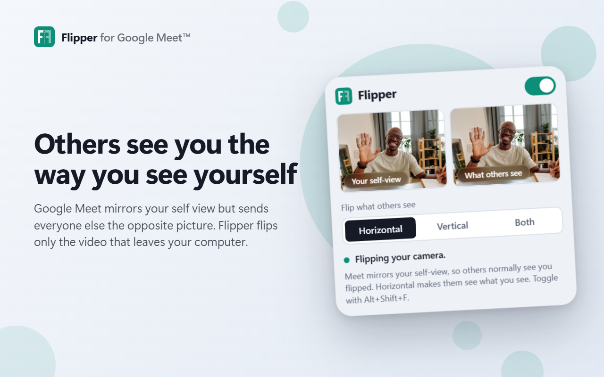

# Flipper for Google Meet™

A Chrome extension that flips the webcam video other people receive from you in Google Meet. Your own self view stays exactly as it is.

## Why

Google Meet shows you a mirrored self view but sends everyone else the un-mirrored picture. Left and right are swapped between what you see and what they see, so when you point at something on your side, they see you pointing the other way. Flipper changes only the copy of your video that leaves your computer:

- **Horizontal**: others see what you see in your self view.
- **Vertical**: the picture goes out upside down.
- **Both**: flipped both ways.

Toggle it from the popup or with `Alt+Shift+F` while a Meet tab is focused. A horizontal flip also mirrors any text behind you, the same way your self view already does.

## Install

- **Chrome Web Store**: https://chromewebstore.google.com/detail/flipper-for-google-meet/baifonnodflncodagjffeiejkepippcj
- **From source**: download this repository, open `chrome://extensions`, turn on Developer mode, click "Load unpacked" and pick the `src` folder.

Needs Chrome 111 or newer.

## Privacy

Flipper has no server, no analytics and no network code. It runs only on `meet.google.com`, changes only your camera video (screen shares and audio go out untouched), and saves two settings on your device: on or off, and the direction. The full policy is in [PRIVACY_POLICY.md](PRIVACY_POLICY.md) and at https://kennito2035.github.io/flipper-for-google-meet/.

## How it works

Plain JavaScript, HTML and CSS on Manifest V3. No framework, no bundler, no dependencies.

| File | Job |
| --- | --- |
| `src/page.js` | Runs inside the Meet page. Wraps the WebRTC sender methods so the camera track is swapped for a flipped copy before it is sent. Frames are flipped with insertable streams, with a canvas fallback. If the flip ever fails, Meet's original track is put back so the video never freezes. |
| `src/bridge.js` | Passes settings between the page and the extension, and handles the keyboard shortcut. |
| `src/popup.*` | The control panel with a live before and after preview. |

## License

The code is under the [MIT License](LICENSE). The photo in the screenshot is not covered by it: "Man with Eyeglasses Smiling while Waving a Hand" by Diva Plavalaguna, from Pexels, used under the Pexels License.

Google Meet is a trademark of Google LLC. This project is not affiliated with or endorsed by Google.
